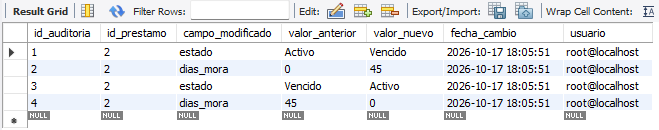
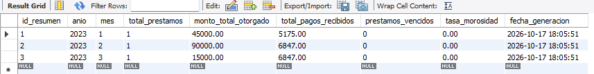
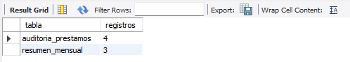
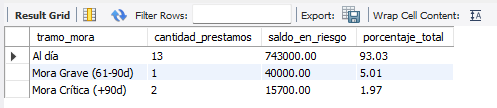
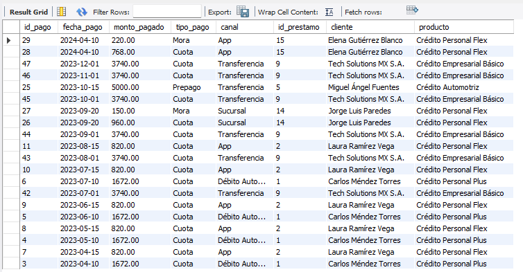
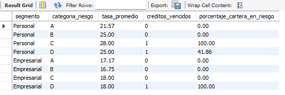
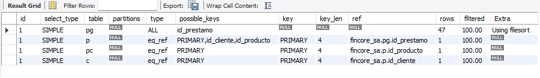
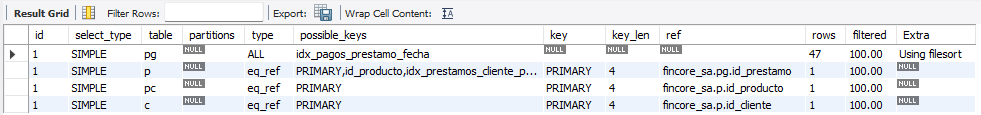

# Análisis de cartera de créditos en SQL

## 📌 Contexto 

- **Problema:** una entidad financiera necesita saber dónde está su riesgo de mora, qué clientes concentran la exposición y si sus tasas reflejan el riesgo de cada cliente.
- **Datos:** base ficticia de FinCore S.A. con 20 clientes, 6 productos de crédito, 21 préstamos y 47 pagos (MySQL 8.0).
- **Qué se construyó:** clasificación de mora, vistas de cartera, auditoría automática con triggers, procedimientos transaccionales de pago y refinanciación, reportes ejecutivos y optimización con índices.
- **Resultado principal:** el 80% de la cartera activa se concentra en solo 5 clientes, toda la mora proviene de clientes de categoría C y D, y la tasa de interés no considera el riesgo del cliente.

---

## Principales hallazgos

- **Exposición concentrada:** los 5 principales deudores suman $640.000, el 80% de la cartera activa. Los dos primeros (Miguel Ángel Fuentes y Constructora Norteña) suman $403.000, la mitad de la cartera, y el primero tiene una exposición 4,2 veces mayor al promedio por cliente ($48.629).
- **La mora se concentra en las categorías de mayor riesgo:** todo el saldo en mora ($55.700) pertenece a clientes de categoría C y D. Las categorías A y B no registran mora, por lo que la clasificación de riesgo sí anticipa el incumplimiento.
- **La mora aparece directamente en tramos graves:** no hay préstamos en mora temprana ni media. El 7% del saldo activo está sobre 60 días de atraso y $15.700 superan los 90 días, con alta probabilidad de pérdida. Esto sugiere que los atrasos se detectan tarde.
- **La tasa no considera el riesgo del cliente:** en los 21 préstamos, la tasa aplicada es exactamente la tasa del producto. Un cliente A y uno D pagan lo mismo por el mismo crédito, por lo que los clientes de bajo riesgo terminan subsidiando la pérdida esperada de los de alto riesgo.

---

## Recomendaciones

1. **Definir límites de exposición por cliente** y revisar las operaciones de los principales deudores, que concentran el 80% de la cartera activa.
2. **Incorporar un recargo de tasa por categoría de riesgo**, para que el precio de cada crédito refleje la pérdida esperada del cliente y no solo el producto.
3. **Endurecer las condiciones para clientes C y D** (montos menores, plazos más cortos y garantías), ya que el 100% de sus préstamos vigentes está en mora.
4. **Gestionar la cobranza desde el primer día de atraso**, con alertas por días de mora, ya que hoy los casos aparecen directamente sobre 60 días.
5. **Ejecutar el resumen mensual de forma periódica** para seguir la evolución de la morosidad en el tiempo.

## 🎯 Objetivos del análisis

- Analizar el estado de la cartera de créditos.
- Clasificar los préstamos según sus días de mora.
- Construir vistas para facilitar el análisis de cartera y clientes.
- Implementar auditoría automática mediante triggers.
- Automatizar el registro de pagos.
- Generar resúmenes mensuales de gestión.
- Automatizar procesos de refinanciación.
- Analizar el aging de la cartera.
- Identificar los clientes con mayor exposición crediticia.
- Analizar el historial de pagos.
- Construir un reporte ejecutivo por segmento y categoría de riesgo.
- Optimizar consultas mediante índices.
- Validar el funcionamiento de las soluciones mediante pruebas.

 ## Tecnologías y herramientas utilizadas

MySQL 8.0 · funciones · vistas · triggers · procedimientos almacenados · transacciones (`START TRANSACTION`, `COMMIT`, `ROLLBACK`) · control de errores con `SIGNAL` · bloqueo de registros con `FOR UPDATE` · CTEs · índices · `EXPLAIN` · `information_schema`

---

## Categorías de riesgo

- A — Excelente
- B — Bueno
- C — Regular
- D — Alto riesgo

---

## Archivos del proyecto

### `sql/01_datos_fincore.sql`

Contiene la estructura y los datos iniciales de la base de datos.

### `sql/02_solucion_fincore.sql`

Contiene la solución desarrollada para el proyecto:

- Función de clasificación de mora.
- Vistas.
- Trigger de auditoría.
- Procedimientos almacenados.
- Consultas analíticas.
- Optimización mediante índices.
- Pruebas de ejecución.

---

## Desarrollo del proyecto

### 1. Función de clasificación de mora

`fn_clasificar_mora` recibe los días de mora de un préstamo y devuelve su tramo según la política interna:

| Días de mora | Categoría |
|---|---|
| 0 o menos | Al día |
| 1 – 30 | Mora Temprana |
| 31 – 60 | Mora Media |
| 61 – 90 | Mora Grave |
| Más de 90 | Mora Crítica |

```sql
CREATE FUNCTION fn_clasificar_mora(dias_mora INT)
RETURNS VARCHAR(30)
DETERMINISTIC
BEGIN
    IF dias_mora <= 0 THEN
        RETURN 'Al día';
    ELSEIF dias_mora BETWEEN 1 AND 30 THEN
        RETURN 'Mora Temprana (1-30d)';
    ELSEIF dias_mora BETWEEN 31 AND 60 THEN
        RETURN 'Mora Media (31-60d)';
    ELSEIF dias_mora BETWEEN 61 AND 90 THEN
        RETURN 'Mora Grave (61-90d)';
    ELSE
        RETURN 'Mora Crítica (+90d)';
    END IF;
END
```

### 2. Vistas de análisis

- **`vw_estado_cartera`:** une clientes, préstamos y productos. Calcula el porcentaje de saldo restante y la categoría de mora de cada préstamo.
- **`vw_resumen_clientes`:** consolida por cliente el total de préstamos, monto otorgado, saldo pendiente, máximo de días de mora y si tiene mora activa. Usa `LEFT JOIN` para incluir también a los clientes sin préstamos.

### 3. Trigger de auditoría

`trg_auditoria_estado` se ejecuta después de cada `UPDATE` sobre `prestamos` y registra en `auditoria_prestamos` cualquier cambio en el **estado** o en los **días de mora**: valor anterior, valor nuevo, fecha y usuario. Usa el operador `<=>` para comparar correctamente valores nulos.

**Prueba:** se cambió el préstamo 2 a `Vencido` con 45 días de mora y luego se restauraron sus valores originales.



*Lectura: el trigger registró 4 cambios en el préstamo 2: el paso a Vencido con 45 días de mora y la restauración a sus valores originales.*

### 4. Procedimientos almacenados

**`sp_registrar_pago`:** registra un pago dentro de una transacción.
1. Verifica que el préstamo exista.
2. Bloquea el registro con `FOR UPDATE` para evitar pagos simultáneos.
3. Valida que el préstamo esté Activo o Vencido, que el monto sea mayor que cero y que no supere el saldo.
4. Descuenta el pago del saldo y lo registra en `pagos`.
5. Si el saldo llega a cero, marca el préstamo como `Cancelado`.
6. Ante cualquier error, ejecuta `ROLLBACK` y devuelve el mensaje.

**`sp_generar_resumen_mensual`:** calcula para un año y mes los préstamos otorgados, el monto total, los pagos recibidos, los préstamos en mora y la tasa de morosidad. Usa `ON DUPLICATE KEY UPDATE` para actualizar el período si ya existe, sin duplicarlo.



*Lectura: se generaron 3 períodos. La tasa de morosidad es 0% porque los préstamos otorgados entre enero y marzo de 2023 no registran mora.*

**`sp_refinanciar_prestamo`:** marca el préstamo original como `Refinanciado` y crea uno nuevo con el saldo pendiente, el nuevo plazo y la nueva tasa, calculando la cuota mensual. Todo ocurre en una sola transacción.



*Verificación: 4 registros de auditoría y 3 períodos de resumen mensual.*

---

## 📈 Consultas analíticas

### Aging de cartera

Agrupa los préstamos Activos y Vencidos por tramo de mora y calcula el saldo y su peso sobre el total.



*Lectura: el 93% del saldo activo está al día. El 7% restante ($55.700) está en mora grave o crítica; no hay casos en mora temprana ni media, lo que indica que los atrasos se detectan tarde.*

### Top 5 de exposición crediticia

Usa dos CTEs (`exposicion` y `promedio`) y un `CROSS JOIN` para comparar a los 5 clientes con mayor saldo contra el promedio de la cartera.


*Lectura: los dos principales clientes suman $403.000, la mitad de la cartera activa. El primero supera en 4,2 veces el promedio por cliente; el quinto ya está bajo el promedio.*

### Historial de pagos

Últimos 20 pagos con su préstamo, cliente y producto.



*Lectura: los pagos más recientes incluyen cargos por mora de los préstamos vencidos, registrados como pagos separados de la cuota.*

### Reporte ejecutivo por segmento y categoría de riesgo

Tasa promedio, créditos vencidos y porcentaje de cartera en riesgo, entendido como el saldo de préstamos con días de mora sobre el saldo total del grupo.



*Lectura: toda la mora se concentra en las categorías C y D. Las diferencias de tasa entre categorías no responden al riesgo, sino a los productos que tomó cada grupo: la tasa aplicada es siempre la tasa del producto.*

---

## 🚀 Optimización con índices

Se analizó con `EXPLAIN` la consulta del historial de pagos antes y después de crear tres índices:

```sql
idx_pagos_fecha_id              ON pagos (fecha_pago DESC, id_pago DESC)
idx_pagos_prestamo_fecha        ON pagos (id_prestamo, fecha_pago)
idx_prestamos_cliente_producto  ON prestamos (id_cliente, id_producto)
```

Como MySQL no soporta `CREATE INDEX IF NOT EXISTS`, se creó un procedimiento auxiliar que consulta `information_schema.statistics` y crea cada índice solo si no existe. Así el script se puede ejecutar varias veces sin errores.

**Antes de los índices:**



**Después de los índices:**



**Resultado:** después de crear los índices, `idx_pagos_prestamo_fecha` e `idx_prestamos_cliente_producto` reemplazaron a los índices automáticos de las claves foráneas y quedaron disponibles para el optimizador. Aun así, el plan no cambió: `pagos` se sigue leyendo completa (`type = ALL`, 47 filas, `Using filesort`). Con un volumen tan bajo, MySQL considera más barato escanear la tabla que usar el índice. Los índices quedan preparados para cuando la tabla crezca a miles de registros, que es donde aportan valor.

---

## Principales aprendizajes

Este proyecto permitió profundizar en el uso de SQL para resolver problemas que van más allá de consultas simples.

Las principales habilidades desarrolladas fueron:

- Llevar SQL más allá de las consultas: lógica de negocio en funciones, procedimientos y triggers.
- Proteger la consistencia de los datos con transacciones, validaciones con `SIGNAL` y bloqueo de registros.
- Diseñar scripts que se puedan ejecutar varias veces sin errores.
- Leer un plan de ejecución y entender cuándo un índice aporta valor y cuándo no.
- Traducir resultados técnicos en hallazgos y recomendaciones de negocio.

---

## Conclusión

La cartera de FinCore es mayormente sana (93% del saldo al día), pero frágil por tres razones:

1. **Depende de pocos clientes:** uno solo concentra el 25% de la cartera activa; su incumplimiento equivaldría a 3,6 veces toda la mora actual.
2. **No cobra el riesgo:** la tasa la define el producto y no la categoría del cliente, mientras que el 100% de los préstamos vigentes de categoría C y D está en mora.
3. **Detecta la mora tarde:** los atrasos aparecen directamente sobre 60 días, cuando la recuperación es más difícil.

**Propuesta:** fijar límites de exposición por cliente, incorporar un recargo de tasa por categoría de riesgo, endurecer las condiciones para clientes C y D, gestionar la cobranza desde el primer día de atraso y evitar que la refinanciación reinicie los días de mora. La morosidad por saldo (hoy 6,97%) debería ser el indicador principal de seguimiento.

La solución combina **SQL + automatización + auditoría + análisis financiero + optimización**: a través de funciones, vistas, triggers, procedimientos almacenados, consultas analíticas e índices, se construyó una base capaz de apoyar la gestión financiera y el análisis de cartera.
